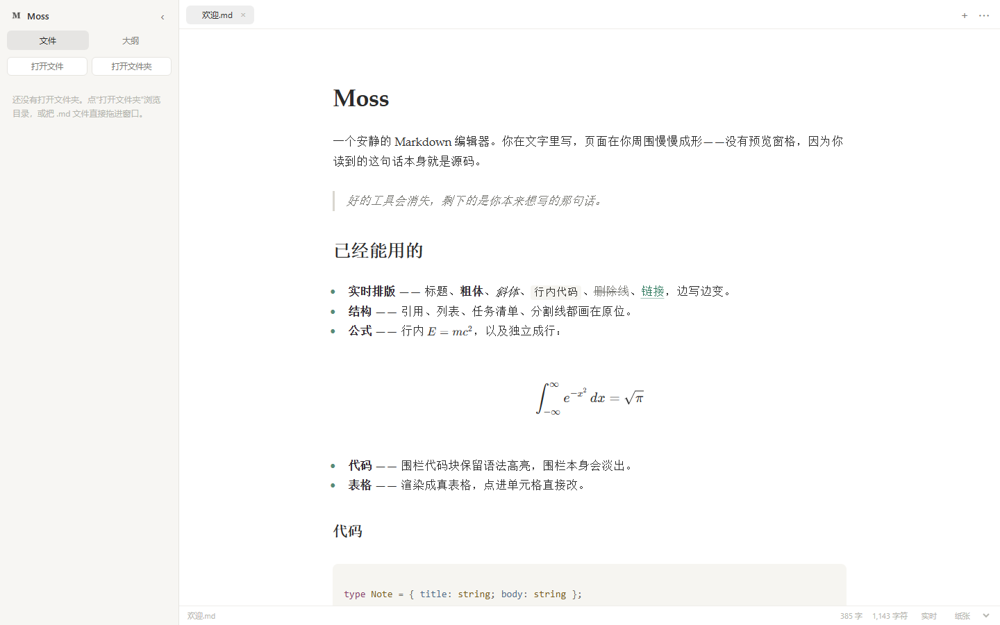

# Moss

[简体中文](README.md) · English

A seamless Markdown editor: **you write in the text, and the page takes shape around it**. No preview pane, no split view — the paragraph you are reading *is* the source.



## What it is

Editing Markdown does not need a split screen. Moss builds that idea on its own engine, written from scratch: a [CodeMirror 6](https://codemirror.net/) core plus a rendering layer that turns the syntax tree into decorations.

It is a working writing tool, not a demo: tables are editable in place, math renders, folders are browsable, and the window frame follows the theme.

## Features

- **Live preview** — headings, bold, italic, inline code, strikethrough, links, quotes, lists, task lists and rules are styled in place. Put the caret inside an element and its raw syntax reappears, dimmed, so you can edit it directly.
- **Tables you can edit in place** — click any cell and type. `Tab` / `Shift+Tab` move between cells, `Enter` commits, `Esc` cancels. `Alt`+click drops the caret into the raw Markdown to add or remove rows.
- **Blocks** — fenced code with syntax highlighting for ~100 languages, GFM tables, horizontal rules.
- **Math** — inline `$...$` / `\(...\)` and display `$$...$$` / `\[...\]`, rendered with KaTeX.
- **Images** — relative paths resolve against the opened folder.
- **Tabs, folder tree, outline** — the outline highlights the section you are reading as you scroll.
- **File watching** — an open file that changes on disk reloads itself, keeping your scroll position. Unsaved edits are never clobbered; you get a notice instead.
- **Modes** — live / source, focus (dims everything but the caret's paragraph), typewriter (keeps the caret mid-screen).
- **Themes** — Paper, GitHub, Sepia, Night, Moss Dark.
- **Chinese / English UI** — localized end to end, switchable from the menu and remembered.
- **Export** — standalone HTML, or print to PDF through the browser.
- **Desktop shell** — single instance, `.md` file associations, theme-aware title bar, native prompt before discarding unsaved work.

## Run it

```bash
npm install
npm run dev            # http://127.0.0.1:5188
```

Production build:

```bash
npm run build
npm run preview        # serves dist/ on 5188
```

Desktop window without packaging:

```bash
npm run desktop        # runs dist/ in Electron; run `npm run build` first
MOSS_DEV=1 npm run desktop   # loads the dev server instead
```

> If your shell sets `ELECTRON_RUN_AS_NODE=1` (some agent harnesses do), Electron starts as plain Node and exits without showing a window. Clear the variable first: `Remove-Item Env:ELECTRON_RUN_AS_NODE`.

## Build a Windows installer

```bash
npm run dist           # vite build + electron-builder --win nsis
```

Output lands in `release/`:

- `Moss-Setup-0.1.0.exe` — NSIS installer (choose install dir, desktop shortcut, `.md` association)
- `win-unpacked/Moss.exe` — portable build

`npm run dist:dir` skips the installer.

The renderer is fully bundled by Vite, so every editor dependency lives in `devDependencies` and the packaged app ships no `node_modules`. The app icon is generated by `tools/make-icon.py` (needs Pillow); pass `A`–`D` to pick a different M:

```bash
python tools/make-icon.py A   # build/icon.ico + public/icon.png
```

## Shortcuts

| Action | Keys |
| --- | --- |
| New / open file / open folder | `Ctrl+N` / `Ctrl+O` / `Ctrl+Shift+O` |
| Save | `Ctrl+S` |
| Close tab / close all | `Ctrl+W` / `Ctrl+Shift+W` |
| Bold / italic / strike / code | `Ctrl+B` / `Ctrl+I` / `Ctrl+Shift+X` / `Ctrl+E` |
| Link | `Ctrl+K` |
| Headings 1–6 / clear | `Ctrl+1` … `Ctrl+6` / `Ctrl+0` |
| Toggle source mode | `Ctrl+/` |
| Focus mode | `Ctrl+Shift+F` |
| Typewriter mode | `F8` |
| Toggle sidebar | `Ctrl+\` |

## Files

Browsers cannot write to disk directly, so the web build uses the **File System Access API** (Chrome / Edge). `Open folder` asks for a directory handle, `Save` writes back through the same handle, and a 2.5-second poll compares `lastModified` to detect outside edits. Firefox and Safari fall back to drag-and-drop plus downloads, with no watching.

The desktop build also supports launching with a file argument, opening `.md` files from Explorer (a second launch hands the file to the existing window instead of starting a new process), and saving through the main process.

## How it is built

```
src/
  editor/
    live-preview.ts   # the whole trick: a StateField that turns the syntax tree into decorations
    table.ts          # table model, cell offsets, in-place cell editor
    widgets.ts        # image, math, checkbox, bullet, rule widgets
    setup.ts          # CodeMirror 6 configuration
    format.ts         # bold/italic/link/heading commands
  ui/                 # tabs, tree, outline (with scroll-spy)
  io/files.ts         # File System Access wrappers, folder scan, mtime polling
  export/html.ts      # standalone HTML + print CSS
electron/main.cjs     # desktop shell (custom title bar, theme-aware chrome, single instance)
electron/preload.cjs  # the one IPC bridge: the renderer tells the shell which colors to use
```

### Two ideas worth remembering

**Decorations must live in a StateField, not a ViewPlugin.**

Multi-line replace decorations (tables, display math) throw `RangeError: Decorations that replace line breaks may not be specified via plugins` when a `ViewPlugin` provides them. It does not crash the page — it silently corrupts CodeMirror's height map, so a 52-line document claims a 16,000px scroll height full of phantom gaps.

**The title-bar overlay eats the tab bar's 1px border.**

If `titleBarOverlay.height` matches the tab bar (42px), the overlay's background swallows the separator line and the top-right corner looks cut off. Drop the overlay to 40px and keep the line at 41–42px.

## Known gaps

- No drag-and-drop images
- No multi-cursor table operations or visual row/column editing
- PDF goes through the browser's print dialog, not a real layout engine
- No filename filter in the sidebar
- Files opened from Explorer have no file watching (only the folder route has a handle to poll)

## About

This is an independent implementation, written from scratch against publicly observable behaviour. It contains no proprietary code, styles, icons or theme resources from any third party.

MIT License.
